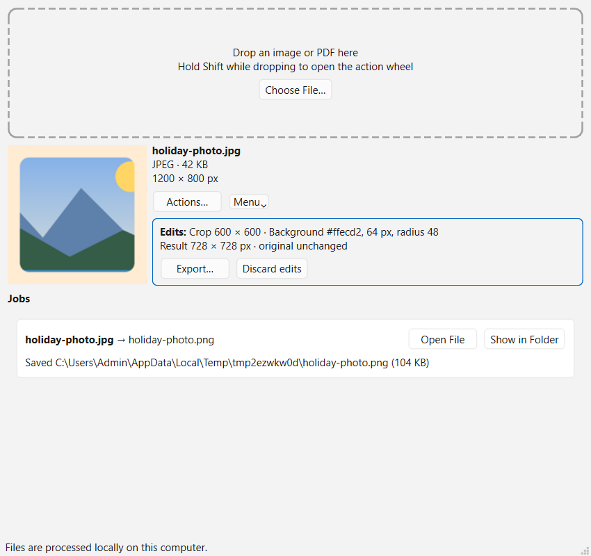
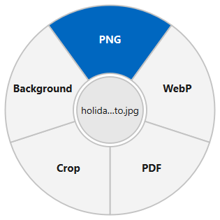
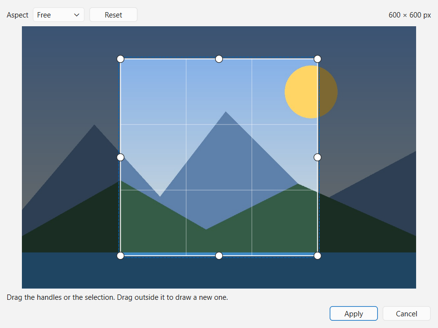
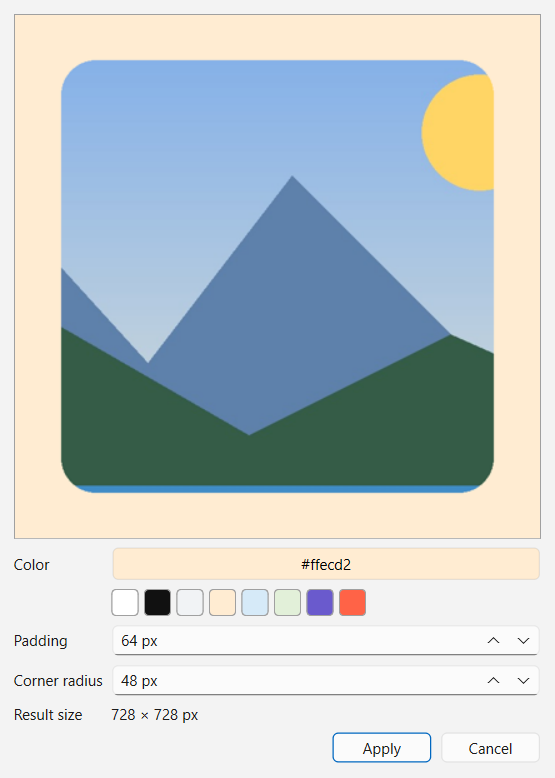

# QuickConvert

Local desktop file conversion and image editing with an action wheel. Files never leave the
machine and originals are never changed. Target OS: **Windows 10/11, 64-bit**.



| Action wheel | Crop | Background |
|---|---|---|
|  |  |  |

**Download / install:** unzip `QuickConvert-<version>-win64.zip` and run `QuickConvert.exe`.
See the [user guide](docs/USER_GUIDE.md).

## Documentation

| Document | Contents |
|---|---|
| [User guide](docs/USER_GUIDE.md) | Install, every feature, troubleshooting |
| [Test report](docs/TEST_REPORT.md) | Automated + acceptance + packaged-build results, performance |
| [Known issues](docs/KNOWN_ISSUES.md) | Limitations and open issues |
| [Third-party notices](docs/THIRD_PARTY_NOTICES.md) | Bundled components and their licenses |

## Developer setup

```powershell
python -m venv .venv
.venv\Scripts\activate
pip install -r requirements-dev.txt     # runtime + pytest, pypdf (test fixtures), PyInstaller
python -m app                           # desktop app (or: python -m app photo.png)
python -m app --help                    # command-line tools over the same core
python -m app selftest                  # check every supported conversion in this environment
pytest
```

Dependencies: `requirements.in` (runtime) and `requirements-dev.in` list direct dependencies;
`requirements.txt` / `requirements-dev.txt` are the pinned versions.

## Building a release

```powershell
powershell -ExecutionPolicy Bypass -File packaging\build.ps1
```

This runs the tests, builds `dist\QuickConvert\` (`QuickConvert.exe` plus `quickconvert-cli.exe`)
with PyInstaller, runs the **self-test inside the packaged build with Python removed from PATH**,
and writes `dist\QuickConvert-<version>-win64.zip`. It refuses to package if tests or the
packaged self-test fail. Bump the version in `app/__init__.py`.

Other scripts in `packaging/`: `make_screenshots.py` (regenerates `docs/screenshots`),
`benchmark.py` (time/memory table for the test report).

## Capability matrix

The UI only offers pairs from `app/services/capabilities.py`. Every pair is covered by
`tests/test_conversion.py::test_every_registered_pair_produces_readable_output` and by the
packaged self-test.

| Input \ Output | JPEG | PNG | WebP | PDF |
|---|---|---|---|---|
| **JPEG** | — | ✓ | ✓ quality | ✓ dpi |
| **PNG**  | ✓ quality, bg color | — | ✓ quality | ✓ dpi |
| **WebP** | ✓ quality, bg color | ✓ | — | ✓ dpi |
| **PDF**  | ✓ page, dpi, password, quality | ✓ page, dpi, password | — | — |

Editing (JPEG/PNG/WebP in → JPEG/PNG/WebP out): crop, background color + padding + corner radius.

Codec requirements: JPEG/PNG/WebP via Pillow's bundled libjpeg-turbo, zlib and libwebp; PDF
rendering via PDFium (pypdfium2); image → PDF via Pillow. All are bundled; nothing to install.

Rules: input type is detected from file content, not the extension. EXIF orientation is applied.
Transparent → JPEG is flattened onto the chosen color (white by default). Image → PDF produces
one page sized to the image at the chosen DPI (default 150). Metadata is stripped unless
`keep_metadata` is set.

## Using the app

- Drag a file onto the drop zone, or click **Choose File…** (Ctrl+O).
- **Hold Shift while dropping** to open the action wheel at the drop point.
- Or click **Actions…** / press **Ctrl+K** for the wheel, or use the **Menu** list.
- Wheel keys: arrows/Tab move, Enter activates, 1–9 pick directly, Esc closes.
- Pick options and where to save, then watch progress in **Jobs**; Cancel stops a running job.
  When done, use **Open File** or **Show in Folder**.
- **Crop** (images): drag the handles or the selection, draw a new one outside it, lock an aspect
  ratio, or nudge with arrow keys (Shift = 10 px). The size shown is in original pixels.
- **Background** (images): pick a color or preset, padding and corner radius with a live preview.
- Crop and background stack. The thumbnail shows the result; **Export…** saves it as PNG/JPEG/WebP
  in the background, **Discard edits** reverts.

### From anywhere (Windows)

QuickConvert keeps running in the **tray** when you close its window (right-click the tray icon →
Quit to exit; it asks first if jobs are still running).

- **Shift+drag from any app:** start dragging a file in Explorer (or anywhere), hold **Shift**, and
  a round *Drop here* bubble appears beside the cursor. Drop the file on it and the action wheel
  opens there. Toggle it in the tray menu. It reads only the mouse/Shift state (no hooks, no
  admin rights), and the bubble sits beside the cursor so other apps' Shift+drags are untouched.
- **Explorer "Send to":** tray menu → *Add to Explorer "Send to" menu*. Then right-click any file →
  Send to → QuickConvert.
- **One instance:** launching again (or Send to) hands the file to the running app.
- **Safe drops:** every drop is accepted as *Copy*. Explorer's Shift+drag means *Move*, and
  accepting a move could let Explorer delete the original; drops that only allow Move are refused.

Diagnostics are logged to `%LOCALAPPDATA%\QuickConvert\logs\quickconvert.log` (technical details
only, never file contents). Settings live in `%APPDATA%\QuickConvert\settings.json`.

## Architecture

```
UI request → validation → capability lookup → job queue → adapter → temp file → verify → rename
```

| Path | Role |
|---|---|
| `app/models/` | `ConversionRequest`, `ConversionOptions`, `EditSpec`, `ConversionJob`, `ConversionResult`, `Capability`, `ErrorCode` |
| `app/services/inspection.py` | `inspect_file`: magic-byte type detection, orientation-aware size, size/pixel/page limits |
| `app/services/capabilities.py` | explicit registry of supported pairs and their options |
| `app/services/conversion.py` | `validate` + `run` a conversion or edit export through an adapter |
| `app/services/jobs.py` | `JobManager.submit / cancel / get_job` on worker threads |
| `app/services/editing.py` | non-destructive crop + background: validation, fast preview, export |
| `app/services/output.py` | safe names, temp-file-then-rename saves, cleanup on failure/cancel |
| `app/adapters/` | Pillow (images, image → PDF) and pypdfium2 (PDF rendering) engines |
| `app/storage/settings.py` | JSON settings in `%APPDATA%\QuickConvert` |
| `app/limits.py` | resource limits |
| `app/integration/` | Shift+drag gesture state machine, Windows input polling + Send to shortcut, single-instance IPC |
| `app/selftest.py` | built-in acceptance check used on packaged builds |
| `app/logging_setup.py` | rotating local log |
| `app/ui/` | main window + drop zone, action wheel, options/export, crop and background dialogs, job rows, tray, drop bubble, safe drag-and-drop (`dnd.py`). `geometry.py` and `crop_geometry.py` hold the Qt-free, unit-tested math |
| `packaging/` | PyInstaller spec, build script, icon/screenshot/benchmark generators |

Error codes: `UNSUPPORTED_PAIR`, `INVALID_INPUT`, `PASSWORD_REQUIRED`, `PERMISSION_DENIED`,
`OUTPUT_EXISTS`, `RESOURCE_LIMIT`, `CONVERSION_FAILED`, `CANCELLED`.

## Status

- [x] Phase 1: repo, venv, lock file, engine proven on fixtures
- [x] Phase 2: conversion core (M1: engine)
- [x] Phase 3: desktop UI: main window, drop zone, action wheel, progress/cancel (M2)
- [x] Phase 4: crop/background dialogs, edit export as background job (M3)
- [x] Phase 5: system-wide Shift+drag bubble, tray, Send to, single instance, safe drops, logging
- [x] Phase 6: PyInstaller release, packaged self-test, handover docs (M4). Still open: a
  clean-machine test and a few manual checks, listed in the [test report](docs/TEST_REPORT.md#5-manual-checks-still-to-do).

## Licensing

All bundled components are under permissive licenses or the LGPL (Qt), so the app can be shared
freely; see [third-party notices](docs/THIRD_PARTY_NOTICES.md). QuickConvert's own source code
has no license file yet. Add one (for example MIT) if others should be allowed to reuse it.
